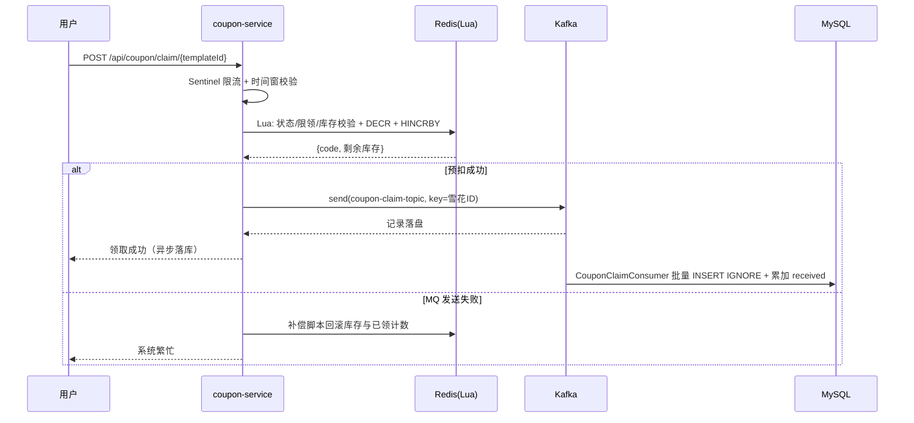
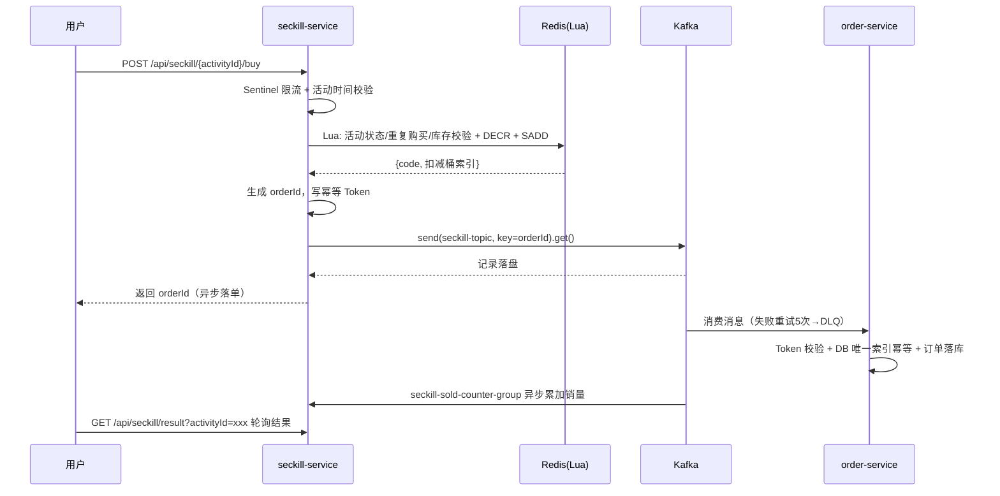

# 优惠券 & 秒杀平台（mall-coupon-platform）

一套对齐大厂主流实现的 Java 后端参考项目：多模块 Spring Boot 3.2 + Spring Cloud Alibaba 2023，覆盖**优惠券生命周期**与**秒杀高并发链路**。重点不在 CRUD，而在**防超卖、防超领、削峰填谷、幂等与最终一致性**。

已具备生产级能力：API 网关统一鉴权限流、Caffeine 多级缓存、热点库存 16 桶拆分、ShardingSphere 分库分表、**Kafka 异步削峰 + Token 幂等 + 死信兜底 + 定时关单**、Sentinel 规则 Nacos 动态下发、Prometheus + Grafana 可观测、K8s 编排，以及本地可运行的**高可用分布式环境**（MySQL 主从 + Redis 哨兵 + Kafka 3 broker）。领券与秒杀的请求线程均只做 Redis 原子预扣 + Kafka 投递，DB 落库全部异步化。

> **实测数据（务必看测试环境）**：单点 demo 环境领券 3244 QPS / p99 58ms、秒杀 3269 QPS / p99 149ms；HA 环境（同样是 `acks=all`）领券 2958 QPS / p99 377ms、秒杀预热后 4094 QPS / p99 302ms。`acks=all` 的真实吞吐代价约 28%（与业界 15-35% 吻合）——早期测到的 380 QPS 是 WSL2 内存 swap thrashing 导致的失真数据，已排查修正。详见 `docs/HA部署与故障转移验证.md`。

Docker Compose 单机编排用于本地 demo，HA 验证用 `docker-compose-ha.yml`，生产多机用 `k8s/` 清单。

> **MQ 选型变更说明**：项目最初用 RocketMQ 事务消息，本机压测时 Broker 被 OOM Kill（`OOMKilled=true`），导致事务半消息超时；此前误判为「WSL2 网络兼容性问题」。现已整体切换到 Kafka，用「Redis Token + 幂等消费 + 定时对账」替代事务消息，并用定时扫描替代延迟消息关单。详见 `perf/README.md` 第 6 节。

---

## 1. 技术栈

| 层次 | 选型 | 用途 |
| --- | --- | --- |
| 语言/框架 | Java 17、Spring Boot 3.2、Spring Cloud 2023 | 基础框架 |
| 接入层 | Spring Cloud Gateway | 统一鉴权、令牌桶限流、路由、CORS |
| 微服务治理 | Spring Cloud Alibaba Nacos | 服务注册发现、配置中心 |
| 流量治理 | Sentinel + Gateway RateLimiter | 网关与服务双层限流 |
| 远程调用 | OpenFeign + Resilience4j | 服务间调用与降级 |
| 数据层 | MySQL 8、MyBatis-Plus、Flyway、ShardingSphere 5.4 | 持久化、数据库版本管理、2 库×4 表分片 |
| 缓存/并发 | Redis 7、Redisson、Lua、Caffeine | 多级缓存、库存分桶预扣、分布式锁 |
| 消息队列 | Kafka 3.7（KRaft） | 削峰、异步落库、Token 幂等、死信队列、定时关单 |
| 可观测性 | Actuator + Prometheus + Grafana + Alertmanager | 业务指标、health/liveness/readiness、Dashboard、告警分级路由 |
| 前端 | Vue 3 + TypeScript + Vite + Element Plus | 运营管理台（券模板/领券/秒杀/订单/监控中心） |
| 接口文档 | Springdoc OpenAPI 3 | Swagger UI |
| 基础设施 | Docker Compose、Kubernetes | 本地 demo、HA 验证与生产编排 |

## 2. 模块划分

```
mall-coupon-platform
├── mall-gateway             网关        :8080  JWT 鉴权、限流、路由、跨域
├── mall-common              公共模块          统一响应/异常、JWT、上下文、多级缓存、Lua、雪花ID、指标、MQ 消息体
├── mall-coupon-service      优惠券服务  :8081  券模板、领券（Kafka 异步落库）、核销、过期
├── mall-seckill-service     秒杀服务    :8082  活动发布、库存分桶预热、抢购预扣、Kafka 投递
└── mall-order-service       订单服务    :8083  Kafka 消费落单、幂等、定时关单、死信兜底
```

每个服务**独立 schema**（`mall_coupon` / `mall_seckill` / `mall_order`），符合微服务数据私有权原则。

## 3. 核心链路

### 3.1 优惠券领取



**为什么用 Lua？** 「查库存 → 判断 → 扣减」如果在客户端分多条命令执行，并发下必然超发。Lua 在 Redis 内原子执行，是单机/单 slot 内防超发的标准解法。

**为什么异步落库？** DB 同步写入是实测瓶颈（同步链路仅 ~100 QPS、p99 1s）。改为 Kafka 异步后请求线程不再碰 DB，批量消费按主键幂等（`INSERT IGNORE` + 实际新增行数累加 received），QPS 提升至 3200+。代价是秒级最终一致性。

### 3.2 秒杀抢购



**关键设计：**

1. **库存预热**：发布活动时把 DB 库存写入 16 个 Redis 桶，之后所有抢购请求不查 DB。
2. **一人一单**：Lua 中用 Set 记录已购用户，消费端再用 `uk_activity_user(activity_id, user_id)` 唯一索引兜底。
3. **失败补偿**：Lua 预扣成功但 Kafka 发送失败，立即执行回滚脚本按实际扣减桶归还库存并移除购买标记。
4. **请求线程零 DB 写入**：订单落库、销量累加全部由 Kafka 消费者异步完成，消费者并发可配（`concurrency`），与瞬时流量解耦。这是实测 QPS 从 ~90 提升到 3200+ 的关键。
5. **异步可感知**：抢购接口返回 orderId，前端轮询 `/api/seckill/result` 获取最终订单状态。
6. **可靠投递**：Token 凭证 + 幂等消费 + 失败重投；重试耗尽转 DLQ 告警；15 分钟未支付由定时任务扫描订单表按 `stock_bucket` 归还库存（不依赖 MQ 延迟消息）。

### 3.3 Hash Tag 与 Redis Cluster

所有同一业务实体的 key 都带 `{id}` hash tag，例如：

```
seckill:{2001}:stock
seckill:{2001}:users
seckill:{2001}:status
```

保证 Lua 访问的多个 key 落在同一 slot，平滑迁移到 Redis Cluster 时无需改代码。

## 4. 本地快速启动

### 4.0 一键启停脚本（推荐）

Windows（PowerShell）与 Linux/macOS 均提供了一键脚本，自动完成「启动 Docker 中间件 → 等待端口就绪 → 缺包自动编译 → 启动 4 个微服务 → 等待 `/actuator/health` 变绿」：

```powershell
# Windows PowerShell
.\scripts\mall.ps1 start             # 一键启动（默认 dev profile）
.\scripts\mall.ps1 status            # 查看微服务与中间件状态
.\scripts\mall.ps1 logs gateway      # 实时查看日志（coupon/seckill/order/gateway）
.\scripts\mall.ps1 stop              # 一键停止（加 -Clean 清空数据卷）
```

```bash
# Linux / macOS
./scripts/mall.sh start
./scripts/mall.sh status
./scripts/mall.sh stop
```

### 4.1 手动启动中间件

```bash
docker compose up -d
docker compose ps   # 确认 MySQL/Redis/Kafka/Nacos/Sentinel 健康
```

> **想验证高可用？** 用 `docker compose -f docker-compose-ha.yml up -d` 启动 HA 栈（MySQL 主从 + Redis 哨兵 + Kafka 3 broker，端口完全隔离），应用加 `--spring.profiles.active=ha` 即可。故障转移实测步骤见 `docs/HA部署与故障转移验证.md`。本地用的是 Compose 编排，不需要 K8s；K8s 清单留给生产多机集群。

MySQL 首次启动会自动执行 `sql/init.sql`，示例数据：

- 券模板 `1001`（新人满100减20）、`1002`（全场9折）
- 秒杀活动 `2001`（iPhone 限量秒杀，库存 100）

### 4.2 编译打包

```bash
mvn clean package -DskipTests
```

### 4.3 启动三个服务

在 IDE 中分别运行（或 `java -jar`）：

```
com.mall.gateway.GatewayApplication             :8080
com.mall.coupon.CouponServiceApplication        :8081
com.mall.seckill.SeckillServiceApplication      :8082
com.mall.order.OrderServiceApplication          :8083
```

生产环境只暴露网关 8080，业务服务端口不对外。上面的 curl 示例直连业务服务便于调试；走网关时把端口换成 8080 并携带 JWT。

> 不启动 Nacos/Sentinel 也能跑：`fail-fast: false`，只会有连接告警。

### 4.4 联调步骤

> 本地联调需激活 `dev` profile（`--spring.profiles.active=dev`）以启用演示签发 Token 接口 `/api/auth/token`；生产/HA 环境不暴露该接口。

```bash
# 1. 获取管理员与普通用户 token（创建/发布模板与活动需要 ADMIN 角色）
ADMIN_TOKEN=$(curl -s "http://localhost:8081/api/auth/token?userId=1&role=ADMIN" | sed -E 's/.*"data":"([^"]+)".*/\1/')
ADMIN_AUTH="Authorization: Bearer $ADMIN_TOKEN"

TOKEN=$(curl -s "http://localhost:8081/api/auth/token?userId=1001" | sed -E 's/.*"data":"([^"]+)".*/\1/')
AUTH="Authorization: Bearer $TOKEN"

# 2. 发布券活动（管理员预热 Redis 库存）
curl -X POST -H "$ADMIN_AUTH" http://localhost:8081/api/coupon/templates/1001/publish

# 3. 领券
curl -X POST -H "$AUTH" http://localhost:8081/api/coupon/claim/1001

# 4. 查看我的券
curl -H "$AUTH" http://localhost:8081/api/coupon/my

# 5. 发布秒杀活动（管理员）
curl -X POST -H "$ADMIN_AUTH" http://localhost:8082/api/seckill/activities/2001/publish

# 6. 抢购
curl -X POST -H "$AUTH" http://localhost:8082/api/seckill/2001/buy

# 7. 轮询抢购结果（等待 MQ 异步落单）
curl -H "$AUTH" "http://localhost:8082/api/seckill/result?activityId=2001"

# 8. 支付订单
curl -X POST -H "$AUTH" http://localhost:8083/api/orders/<orderId>/pay
```

Swagger UI：<http://localhost:8081/swagger-ui.html>（8082/8083 同理）

## 5. 主要接口

| 服务 | 方法 | 路径 | 说明 |
| --- | --- | --- | --- |
| coupon | POST | `/api/coupon/templates` | 创建券模板 |
| coupon | POST | `/api/coupon/templates/{id}/publish` | 发布并预热库存 |
| coupon | POST | `/api/coupon/claim/{templateId}` | 领券 |
| coupon | GET | `/api/coupon/my` | 我的优惠券 |
| coupon | POST | `/api/coupon/use` | 核销优惠券 |
| seckill | POST | `/api/seckill/activities` | 创建秒杀活动 |
| seckill | POST | `/api/seckill/activities/{id}/publish` | 发布活动 |
| seckill | POST | `/api/seckill/{activityId}/buy` | 抢购 |
| seckill | GET | `/api/seckill/result?activityId=` | 查询抢购结果 |
| order | GET | `/api/orders/{orderId}` | 订单详情 |
| order | POST | `/api/orders/{orderId}/pay` | 支付 |
| order | POST | `/api/orders/{orderId}/cancel` | 取消 |

## 6. 生产级能力说明

已落地的关键能力：

- **热点库存分桶**：单个活动的库存拆成 16 个 key（`seckill:{id}:stock:{bucket}`），Lua 从 userId 对应桶开始轮询，既打散 Redis Cluster 热点，又避免某桶售罄导致少卖。回滚按实际扣减桶归还。
- **多级缓存**：Caffeine 本地缓存（10s）+ Redis（30min），发布活动时通过 Pub/Sub 广播失效所有实例；空值哨兵短 TTL 防穿透。
- **MQ 可靠性**：Redis Token 凭证 + Kafka 幂等消费替代事务消息（不依赖 Broker 回查）；发送失败立即回滚预扣；消费重试耗尽进 DLQ 告警；15 分钟未支付由定时扫描订单表按 `stock_bucket` 关单并归还库存。
- **分库分表**：`user_coupon` 按 `user_id`、`seckill_order` 按 `activity_id` 分 2 库×4 表，见下方启用方式。
- **双层限流**：网关按用户的令牌桶 + 服务层 Sentinel 资源限流；Sentinel 规则支持 Nacos 动态下发（`sentinel.nacos.enabled=true`，关闭时本地规则兜底）。
- **数据库版本管理**：Flyway，每个服务独立迁移自己的 schema（`db/migration/V1__init.sql`），默认关闭、由 `FLYWAY_ENABLED=true` 开启；与 Docker initdb.d 二选一。详见 `docs/工程化配置说明.md`。
- **代码质量**：Checkstyle（规范，CI 门禁）+ JaCoCo（覆盖率报告）+ Spotless（格式工具，存量代码未统一前不作门禁），CI 模板见 `.github/workflows/ci.yml`。
- **可观测性**：`/actuator/prometheus` 暴露 `mall_seckill_success_total`、`mall_seckill_soldout_total`、`mall_seckill_latency` 等业务指标；`k8s/alerts.yml` 告警规则 + `monitoring/grafana/` Dashboard（10 面板，含 HA 状态）。
- **高可用验证环境**：`docker-compose-ha.yml` 一键起 MySQL 主从 + Redis 1主1从3哨兵 + Kafka 3 broker，实测停主库后 15s 内自动切主、应用无感。
- **✅ 领券异步化**：领券与秒杀均为「Redis 预扣 + Kafka 异步落库」，请求线程零 DB 写入，对账零超卖零重复。见 `perf/README.md`。
- **✅ Kafka 事务可选能力**：`kafka.transaction.enabled=true` 开启 read-process-write 原子提交（Exactly-Once），默认仍用 at-least-once + 幂等 + 对账。见 `docs/Kafka事务Exactly-Once说明.md`。
- **✅ 单元测试**：`mall-common` 覆盖 JWT / 雪花 ID / 消息序列化 / Redis Key hash tag / Lua 脚本完整性，共 14 个用例。

上线前仍需补齐：

- **库存预热自动化**：发布活动改由定时任务/配置中心触发，Redis 宕机时提供降级开关。
- **Nacos / Redis Cluster 本地验证**：3 节点 Nacos 与 6 节点 Redis Cluster 编排已写好（`docker-compose-nacos-cluster.yml` / `docker-compose-redis-cluster.yml`），但本地 8GB 装不下，需在云环境启动验证。
- **跨系统强一致**：Kafka 事务只保证 Kafka 内部原子性；要跨 MySQL + Kafka 真正一致需 outbox 模式。当前用幂等 + 定时对账兜底，秒杀链路按行业惯例采用最终一致性。

### 6.1 启用分库分表

```bash
# 1. 初始化分片库表
mysql -uroot -p < sql/sharding-init.sql

# 2. 启动服务时激活 sharding profile
java -jar mall-coupon-service.jar --spring.profiles.active=sharding
java -jar mall-order-service.jar --spring.profiles.active=sharding

# 分片规则见各服务的 sharding.yaml（ds${0..1}.table_${0..3}）
```

### 6.2 可观测性

各服务（含网关）均暴露 `/actuator/prometheus`（网关依然关闭 `/actuator/gateway` 防无鉴权改路由）。**本地一键启动监控栈**：Windows 执行 `.\scripts\monitor.ps1 start`（Linux/macOS 执行 `./scripts/monitor.sh start` 或 `docker compose -f docker-compose-monitoring.yml up -d`），包含 Prometheus :9090、Alertmanager :9093、Grafana :3000（admin/admin）、Redis/Kafka exporter；Dashboard 12 个面板（服务健康/QPS/P99/5xx/JVM/GC/业务指标/Kafka 积压/ISR）通过 provisioning 自动加载。K8s 环境按 `k8s/prometheus-config.yaml` 配 Pod 发现，告警见 `k8s/alerts.yml`。详见 `docs/监控编排使用说明.md`。

前端管理台在 `web/`（Vue 3 + Vite + Element Plus），`cd web && npm install && npm run dev` 后访问 :5173，提供券模板/领券/秒杀/订单/监控中心界面，详见 `web/README.md`。

## 7. 目录说明

```
sql/init.sql                建库建表 + 演示数据（Docker initdb.d 方式）
sql/sharding-init.sql       分库分表初始化（2 库×4 表）
db/migration/               Flyway 迁移脚本（在各服务 resources 下，按 schema 拆分）
config/checkstyle/          Checkstyle 规则
.github/workflows/ci.yml    GitHub Actions CI 模板（参考）
sql/kafka-migration.sql     RocketMQ→Kafka 增量迁移（seckill_order.stock_bucket）
docker-compose.yml          本地单机 demo 中间件（Kafka 单节点 KRaft）
docker-compose-ha.yml       本地 HA 验证：MySQL 主从 + Redis 哨兵 + Kafka 3 broker
docker-compose-monitoring.yml     可观测性栈：Prometheus/Alertmanager/Grafana/Redis+Kafka exporter
web/                        Vue 3 管理台前端（npm run dev / build）
docker-compose-nacos-cluster.yml   Nacos 3 节点集群（云环境用）
docker-compose-redis-cluster.yml   Redis 3 主 3 从 Cluster（云环境用）
build-images.sh / Dockerfile*     业务镜像构建（多阶段 + 复用 jar 两种）
k8s/                        生产编排：Deployment/Service/HPA/Ingress/Prometheus/告警/deploy.sh
monitoring/                 Prometheus 配置/告警规则 + Alertmanager 路由 + Grafana Dashboard 与 provisioning
perf/                       压测引擎、报告（24 份）与基准结果
docs/API示例.md             完整 curl 示例与压测命令
docs/HA部署与故障转移验证.md  HA 编排、故障转移实测、QPS 下降根因排查
docs/云服务器部署方案.md      云服务器选型、部署、压测、成本
docs/Kafka事务Exactly-Once说明.md  可选事务能力的使用与边界
docs/工程化配置说明.md      Flyway / Lint / CI 的使用方式
docs/监控编排使用说明.md    Prometheus/Grafana/Alertmanager 一键启动与抓取目标
web/README.md              管理台前端启动、功能与部署说明
```

## 8. 环境要求

- 本地 HA 验证：WSL2 建议 `memory=8GB`（`C:\Users\<你>\.wslconfig`）+ `swap=1GB` + `autoMemoryReclaim=gradual`。13 个容器在 6GB 下会 swap thrashing 导致磁盘打满、daemon 假死。
- 压测要在**内存充裕 + 服务预热**状态下做，否则数据失真（详见 HA 文档的 QPS 排查章节）。

---

> 本项目用于学习与工程参考。生产环境请务必替换默认 JWT 密钥、数据库密码，并按实际流量重新评估所有阈值。
